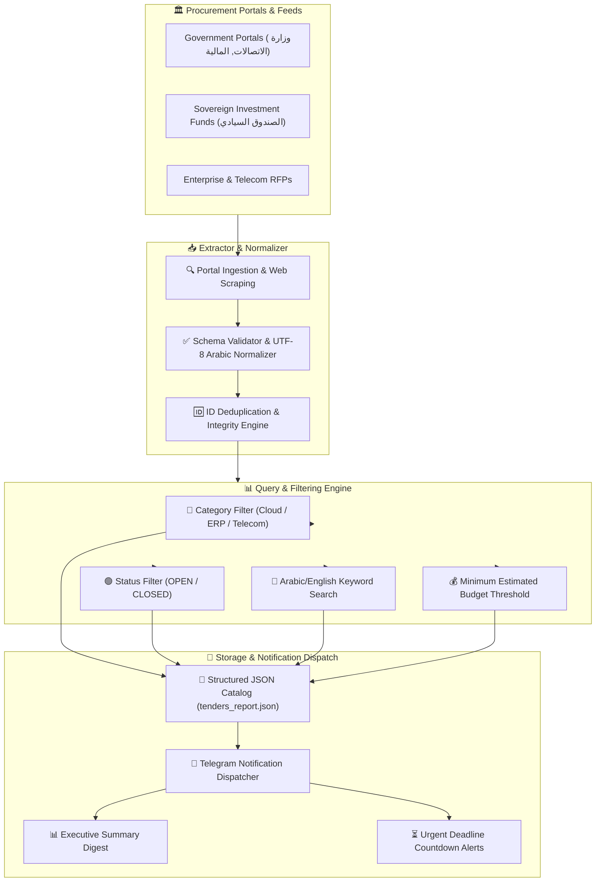

# 📑 tender-opportunity-tracker

> **Topics:** `web-scraping` `tender-tracker` `procurement` `rfp` `automation` `arabic-scraper` `business-intelligence`


[](https://github.com/MobileConduit/tender-opportunity-tracker/releases/tag/v1.0.0)
[](https://github.com/MobileConduit/tender-opportunity-tracker/actions)
[](LICENSE)
[](https://github.com/MobileConduit)
[](https://python.org)

Automated web scraper, metadata extractor, and opportunity tracker designed to monitor government tenders, sovereign fund bids, and corporate RFPs with structured Arabic metadata extraction, JSON filtering, and automated Telegram alerting.

---

## 🏗️ Architecture & Processing Pipeline



---

## ✨ Key Features

- **Arabic NLP & Metadata Extraction:** Native UTF-8 support for Syrian and MENA procurement portals, government entities, and tender titles.
- **Deduplication & Validation:** Eliminates duplicate postings and validates required fields (`id`, `title`, `entity`, `deadline`, `status`).
- **Granular JSON Filtering:** Filter bids by sector category, status (`OPEN`, `CLOSED`), entity substring, Arabic keywords, and minimum USD budget.
- **Telegram Notification Templates:** Rich Markdown alerts for instant RFP detection, daily executive summaries, and deadline countdown warnings.
- **Zero Runtime Dependencies:** Built cleanly with Python standard library modules with no heavyweight external scrapers required.
- **Automated CI/CD:** GitHub Actions workflow running tests across Python 3.10, 3.11, and 3.12.

---

## ⚙️ Configuration

Copy `.env.example` to `.env` to configure your environment:

```bash
cp .env.example .env
```

Configuration variables:

| Variable | Description | Default |
| :--- | :--- | :--- |
| `OUTPUT_PATH` | Output JSON catalog filepath | `tenders_report.json` |
| `TELEGRAM_BOT_TOKEN` | Bot API token from @BotFather | Optional |
| `TELEGRAM_CHAT_ID` | Telegram Chat/Channel ID for alert broadcasts | Optional |
| `DEFAULT_FILTER_CATEGORY` | Default category filter | `IT & Cloud Infrastructure` |
| `DEFAULT_FILTER_STATUS` | Default tender status filter | `OPEN` |
| `TENDER_PORTAL_URL` | Target procurement endpoint or feed URL | Optional |

---

---

## ⚙️ Installation & Setup

```bash
git clone https://github.com/MobileConduit/tender-opportunity-tracker.git
cd tender-opportunity-tracker
pip install -r requirements.txt
```

## 🚀 Usage

### 1. Basic Scan & Export
```bash
python tracker.py --out active_tenders.json
```

### 2. Scan with Category & Status Filters
```bash
python tracker.py --filter-category "IT & Cloud Infrastructure" --filter-status "OPEN"
```

### 3. Arabic Keyword Search
```bash
python tracker.py --keyword "الاتصالات" --notify
```

### 4. Custom Source File Scan
```bash
python tracker.py --input test_tenders.json --out filtered_tenders.json
```

---

## 🧪 Testing & CI/CD

Run test suite locally:

```bash
pytest -v
```

All 13 automated unit tests cover scraper extraction, deduplication, UTF-8 Arabic text parsing, JSON filtering, and Telegram alert template rendering.

---

## 👤 Author & Maintainer

**Eng. MHD. Shadi AL-Hasan**  
- **Role:** Executive CTO & Enterprise Solutions Architect  
- **Email:** [mhd.shadi.alhasan@gmail.com](mailto:mhd.shadi.alhasan@gmail.com)  
- **Phone / WhatsApp:** [+963934005922](tel:+963934005922)  
- **Location:** Damascus, Syria  
- **GitHub:** [MobileConduit](https://github.com/MobileConduit)  

---

## 📄 License

This project is licensed under the MIT License - see the [LICENSE](LICENSE) file for details.  
Copyright (c) 2026 **MHD. Shadi AL-Hasan**. All rights reserved.